<div align="center">

# 🔓 Wireshark SOC Lab: Reading a Plain-Text Office Chat with Follow TCP Stream

**Showing how anyone who can capture the traffic can read an unencrypted chat, including the passwords shared in it**
</div>

<p align="center">
  
  
  
  
  
</p>

---

## 📌 Project Overview

This is a Wireshark SOC lab from the Networkwalks internship. The scenario:

> *You are a SOC analyst. Your manager says some staff use an old office chat tool that sends messages in plain text. Capture the traffic and use Follow TCP Stream to read one chat and see what was shared.*

The lab runs in the browser. It gives you a Windows 11 PC with Wireshark installed, and you complete **10 tasks** (10 marks each) by capturing traffic, finding the chat among the web traffic, following its TCP stream, and reading what was said. I followed the lab's written instructions for each task. My final score was **90/100**.

All the names, passwords and ticket numbers in this lab are simulated lab data, not real credentials.

| 🔎 Item           | ✅ Result                                                   |
| ----------------- | ----------------------------------------------------------- |
| Chat              | `192.168.10.45` to the chat server `192.168.10.20`          |
| TCP port          | `5000` (stream 5)                                           |
| Shared in chat    | A temporary password and the guest Wi-Fi password           |
| Lesson            | Use encrypted tools (TLS/HTTPS)                             |

---

## 🎯 Objectives

- Capture traffic in Wireshark and read the total packet count.
- Use **Statistics → Conversations** to find the one conversation that is not web traffic.
- Work out which computer started the chat from the first SYN packet.
- Use **Follow → TCP Stream** to turn packets into a readable conversation.
- Read the stream number, size and content of the chat.
- Explain why sending passwords in plain text is a security problem.

---

## 🛡️ Why This Matters for Security

Wireshark can rebuild a whole conversation from its packets. If the application does not use encryption, anything typed into it, including passwords, can be read by anyone who can capture the traffic.

For a SOC analyst, this lab shows two things: how to find the odd one out among normal traffic, and what the impact is when a tool sends sensitive data in plain text. Credentials found this way in a real network would need to be treated as exposed.

> ⚠️ **Important:** Reading other people's messages in a capture is sensitive. Only capture and analyze traffic on networks you own or have explicit permission to monitor. This lab runs in a simulated environment provided by Networkwalks.

---

## ⚙️ Lab Configuration

| 🧩 Component        | ⚙️ Configuration                                                               |
| ------------------- | ------------------------------------------------------------------------------ |
| 🌐 Platform         | Networkwalks online lab (`networkwalks.com/wireshark-lab4`)                    |
| 🖥️ Analyst PC       | Windows 11 PC in the lab (user `Student`)                                      |
| 🦈 Tool             | Wireshark, capturing on the `WiFi` interface                                   |
| 📦 Capture Size     | 246 packets                                                                    |
| 🧭 Capture Point    | Switch with a SPAN port mirroring traffic to the analyst PC                    |
| 🧑‍💻 SOC Analyst      | `192.168.10.10`                                                                |
| 💬 Chat Server      | `192.168.10.20`                                                                |
| 🏆 Scoring          | 10 tasks × 10 marks; each hint costs 10% of that task's marks                  |

### Topology (from the lab brief)

```text
SOC Analyst (Wireshark)         Staff PC (IP unknown at the start)
 192.168.10.10                           │
        │                                │
        └──────────── Switch ────────────┘
                  (SPAN: packet capture point)
                          │
                 Other hosts, Chat Server 192.168.10.20
```

---

# 🪜 Lab Procedure

## Step 1. Sign In and Capture the Traffic (Task 1)

I signed in to the Windows PC, opened Wireshark, and double-clicked the `WiFi` interface to start the capture. The status bar shows **Packets: 246**.

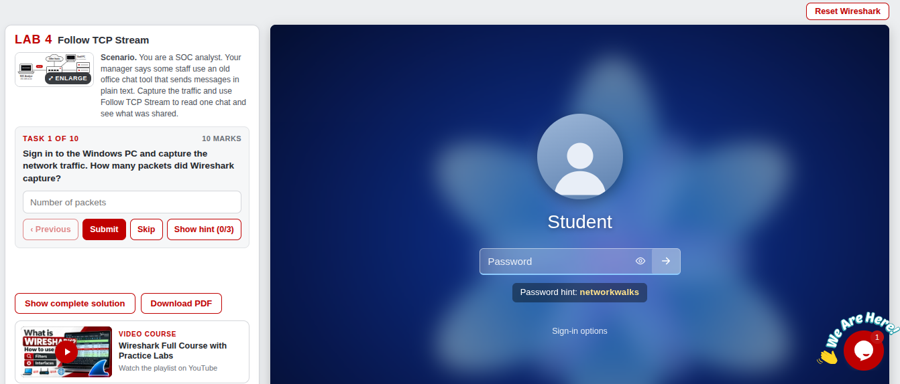

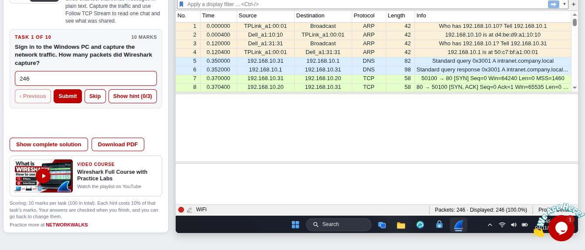

**Answer: 246.**

---

## Step 2. Find the Chat Port (Task 2)

Most of the traffic is web traffic on port 80 or 443. To find the one conversation that is different, I opened **Statistics → Conversations** and clicked the **TCP** tab. Looking at the **Port B** column, almost every row shows 80 or 443, but one shows **5000**: `192.168.10.45:49731 ↔ 192.168.10.20:5000` (stream 5).

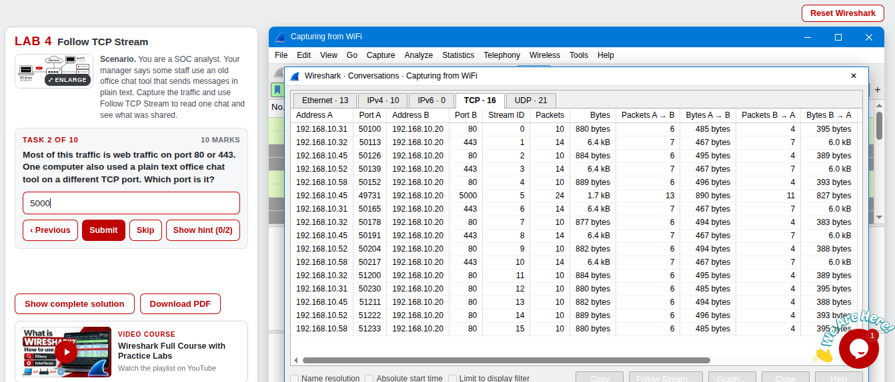

**Answer: 5000.**

---

## Step 3. Find Who Started the Chat (Task 3)

I isolated the chat with this filter:

```text
tcp.port == 5000
```

The first packet is a **SYN**. The computer that sends the first SYN starts the connection, and its Source is **`192.168.10.45`**. The next two packets complete the TCP handshake: `SYN, ACK` from the server, then `ACK` from the client.

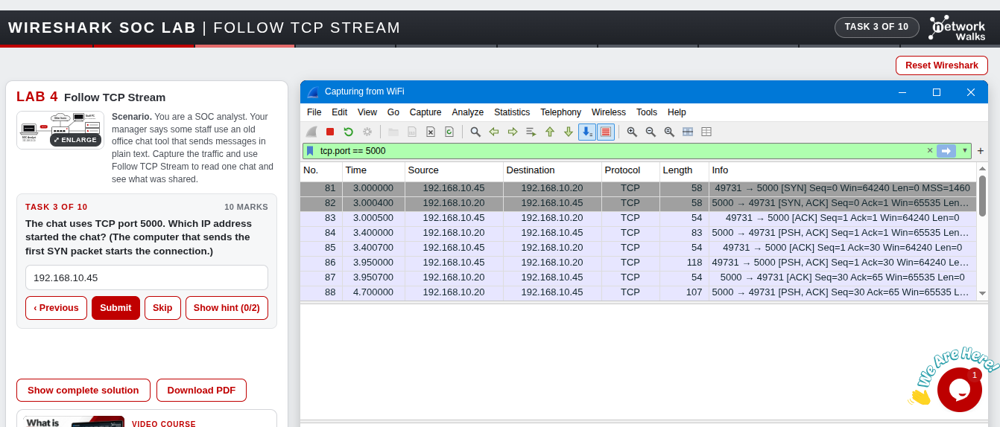

**Answer: `192.168.10.45`.**

---

## Step 4. Follow the TCP Stream (Task 4)

With the filter applied, I right-clicked a packet that carries data (Len above 0) and chose **Follow → TCP Stream**. Wireshark rebuilt the whole chat as readable text. The window title shows **`tcp.stream eq 5`**.

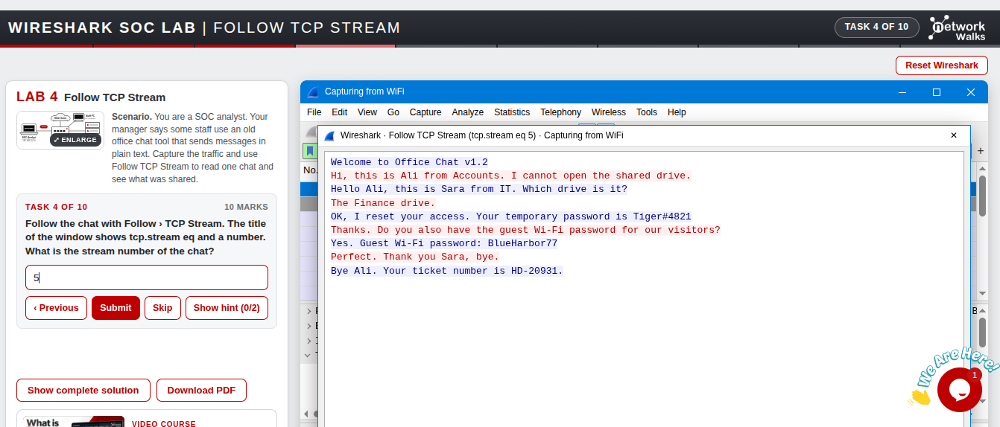

**Answer: 5.**

---

## Step 5. Read the Size of the Chat (Task 5)

The bar at the bottom of the Follow TCP Stream window summarizes the conversation: **4 client packets, 5 server packets, 9 turns**, and **Entire conversation (413 bytes)**.

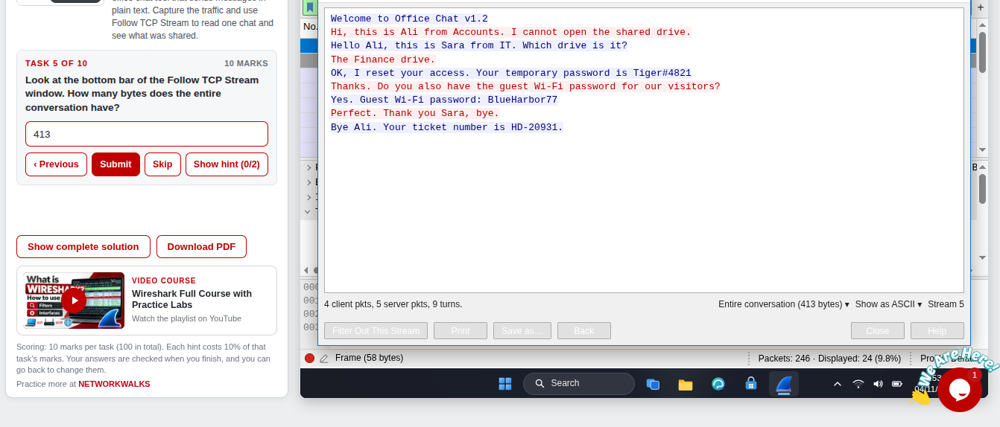

**Answer: 413.**

---

## Step 6. Read the Chat (Tasks 6 to 9)

The conversation, as shown in the Follow TCP Stream window (red is the client and blue is the server):

```text
Welcome to Office Chat v1.2
Hi, this is Ali from Accounts. I cannot open the shared drive.
Hello Ali, this is Sara from IT. Which drive is it?
The Finance drive.
OK, I reset your access. Your temporary password is Tiger#4821
Thanks. Do you also have the guest Wi-Fi password for our visitors?
Yes. Guest Wi-Fi password: BlueHarbor77
Perfect. Thank you Sara, bye.
Bye Ali. Your ticket number is HD-20931.
```

| 🎯 Task | ❓ Question                                           | ✅ Answer       |
| ------- | ----------------------------------------------------- | --------------- |
| 6       | First name of the staff member who asks for help      | `Ali`           |
| 7       | Shared drive the staff member could not open          | `Finance`       |
| 8       | Temporary password IT gave in the chat                | `Tiger#4821`    |
| 9       | Guest Wi-Fi password                                  | `BlueHarbor77`  |

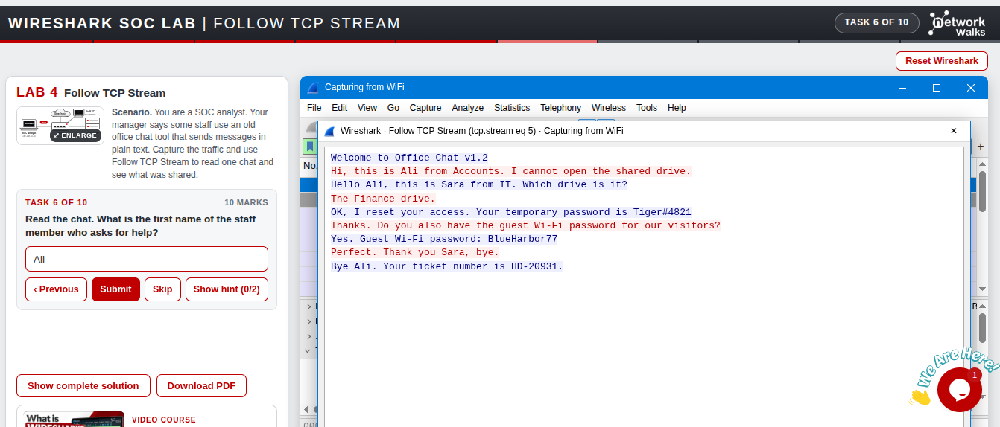

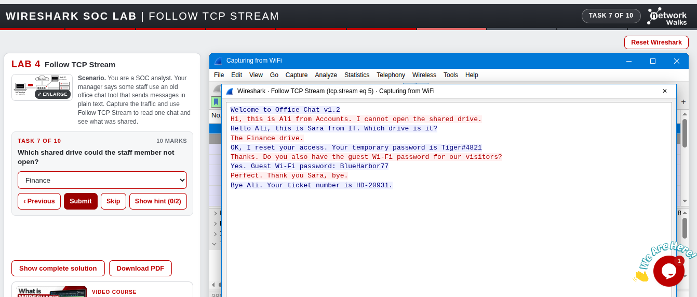

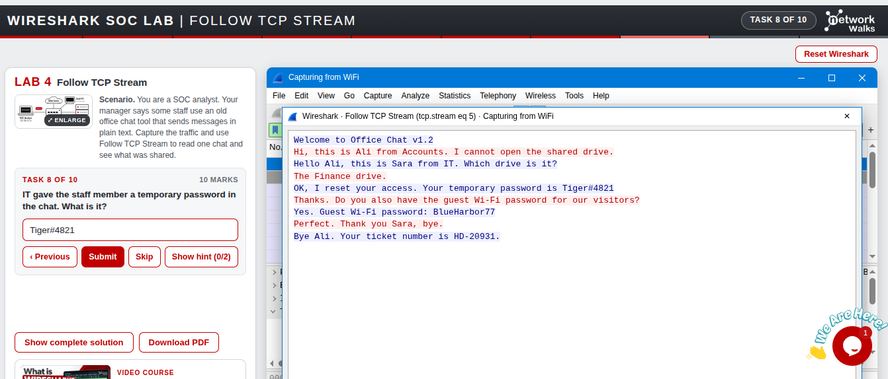

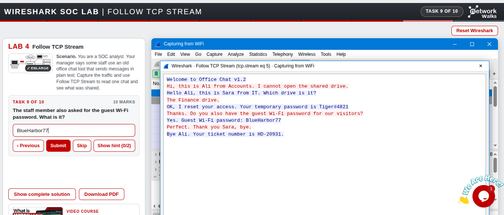

---

## Step 7. Read the Text Colour (Task 10)

The last task asks for the colour of the text sent by the computer that started the chat (the client). I submitted **Blue**, which was wrong. The client, `192.168.10.45` (Ali), sends the **red** text, and the server sends the **blue** text (see *Challenges Encountered*).

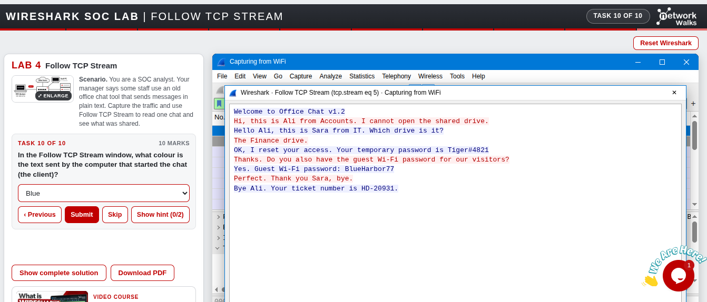

**Correct answer: Red.**

---

## Step 8. Result

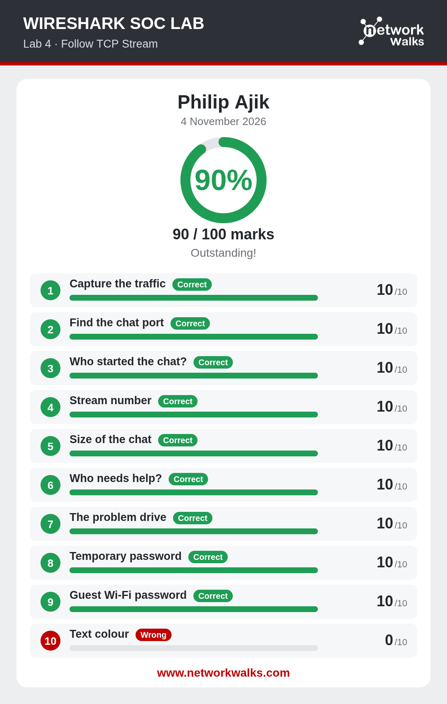

---

# 📊 Results

| #  | 🎯 Task                 | ✅ Answer                          | 🔎 How I Found It                                          | 🏆 Result |
| -- | ----------------------- | ---------------------------------- | ---------------------------------------------------------- | --------- |
| 1  | Capture the traffic     | `246` packets                      | Status bar after starting the capture                      | ✅ 10/10  |
| 2  | Find the chat port      | `5000`                             | Statistics → Conversations → TCP tab, Port B column        | ✅ 10/10  |
| 3  | Who started the chat    | `192.168.10.45`                    | Source of the first SYN in `tcp.port == 5000`              | ✅ 10/10  |
| 4  | Stream number           | `5`                                | Title of the Follow TCP Stream window (`tcp.stream eq 5`)  | ✅ 10/10  |
| 5  | Size of the chat        | `413` bytes                        | Bottom bar of the Follow TCP Stream window                 | ✅ 10/10  |
| 6  | Who needs help          | `Ali`                              | First red message in the chat                              | ✅ 10/10  |
| 7  | The problem drive       | `Finance`                          | Red message: "The Finance drive."                          | ✅ 10/10  |
| 8  | Temporary password      | `Tiger#4821`                       | Blue message from IT                                       | ✅ 10/10  |
| 9  | Guest Wi-Fi password    | `BlueHarbor77`                     | Blue message from IT                                       | ✅ 10/10  |
| 10 | Text colour of the client | `Red`                            | Colour of the messages from `192.168.10.45`                | ❌ 0/10 (I submitted `Blue`) |

### Timeline of the Chat (from the packets)

| ⏱️ Time (s) | 📦 Packet | 🔄 What happened                                                         |
| ----------- | --------- | ------------------------------------------------------------------------ |
| 3.0000      | 81        | `192.168.10.45` sends a SYN to port 5000 on `192.168.10.20`              |
| 3.0004      | 82        | Server replies `SYN, ACK`                                                |
| 3.0005      | 83        | Client replies `ACK`: the connection is open                             |
| 3.4000      | 84        | Server sends the first data (the welcome banner)                         |
| 3.9500      | 86        | Client sends the first message (Ali asking for help)                     |
| 4.7000      | 88        | Server sends its reply                                                   |

---

# 🔭 Observations Beyond the Task Questions

These are things I saw in the screenshots while documenting. The lab does not ask for them.

1. **The chat stands out by size as well as by port.** In the Conversations tab, the port 5000 conversation has 24 packets. The web conversations have 10 packets (port 80, about 880 bytes) or 14 packets (port 443, about 6.4 kB).
2. **The server speaks first.** The client opens the connection, but the first data comes from the server: the welcome banner at 3.4 s, before the client's first message at 3.95 s. That is why the first line in the Follow window is blue.
3. **Only 24 of the 246 packets belong to the chat.** After `tcp.port == 5000`, the status bar shows `Displayed: 24 (9.8%)`.
4. **Two credentials were shared in a single short chat.** A temporary password and a guest Wi-Fi password were both sent in plain text, together with a help desk ticket number (`HD-20931`).
5. **No identity check is visible in the chat.** IT resets access and shares a password for someone who says they are "Ali from Accounts". Whether IT verified them some other way cannot be seen in the capture, so in a real setting that is a process question worth asking.
6. **The capture depends on the SPAN port.** The analyst PC sees this chat because the switch mirrors traffic to it. Anyone else in a position to capture the traffic could read it the same way.

---

# 🐞 Challenges Encountered

I had no technical difficulties with Wireshark or the lab environment. The one thing I got wrong was **Task 10**.

* **Issue:** I submitted **Blue** as the colour of the text sent by the client. The correct answer is **Red**.
* **What the evidence shows:** Task 3 had already established that `192.168.10.45` (Ali) started the chat, since it sent the first SYN, so it is the client. Its messages are the red ones. The blue ones come from the server side (Sara from IT, plus the welcome banner).
* **Result:** 0/10 on that task, so the final score was 90/100 instead of 100/100.
* **What I'll do differently:** tie the colour back to the earlier answer. Decide who the client is first (the host that sent the first SYN), then match that host to a colour in the Follow window. The computer that speaks first is not always the one that started the connection.

---

# 💡 Key Learnings

1. **Plain text means readable by anyone who can capture:** Follow TCP Stream turned a handful of packets into a full conversation, including two passwords.
2. **Look for the odd one out:** in Statistics → Conversations, one row on port 5000 stood out among rows on ports 80 and 443.
3. **A filter isolates one conversation:** `tcp.port == 5000` took 246 packets down to 24 related to the chat.
4. **The first SYN tells you who started the connection:** that host is the client.
5. **Follow TCP Stream gives more than the text:** the title gives the stream number (`tcp.stream eq 5`), and the bottom bar gives packets per side, turns, and total bytes.
6. **Client and server colours are fixed by role, not by who talks first:** I lost marks by not linking the colour to the client I had already identified.
7. **Exposed credentials should be treated as compromised:** a password sent in plain text should be changed, and sensitive information should go through encrypted tools (TLS/HTTPS).
8. **Document the mistakes too:** the wrong answer showed me more than a perfect score would have.

---

# 🔐 Security & Ethical Use

This lab is for education only and ran in a simulated environment provided by Networkwalks. The names, passwords and ticket number in this document are lab data. Only capture and read network traffic on networks and devices you own or have permission to monitor.

---

# 🔗 Tools & Resources

- **Online lab:** [https://networkwalks.com/wireshark-lab4/](https://networkwalks.com/wireshark-lab4/)
- **Wireshark:** [https://www.wireshark.org/download.html](https://www.wireshark.org/download.html)
- **NetworkWalks:** [https://networkwalks.com](https://networkwalks.com)

---

# 👤 Author

**Philip Ajik**  
Cybersecurity Student (Batch B082) — Networkwalks Academy  
LinkedIn: [https://www.linkedin.com/in/philip-ajik-a22944384](https://www.linkedin.com/in/philip-ajik-a22944384)

---

## 📌 Project Information

**Program Name:** Cybersecurity at Networkwalks | **Task:** Wireshark SOC Lab 4 | **Project:** Follow TCP Stream | **Repository:** GitHub
